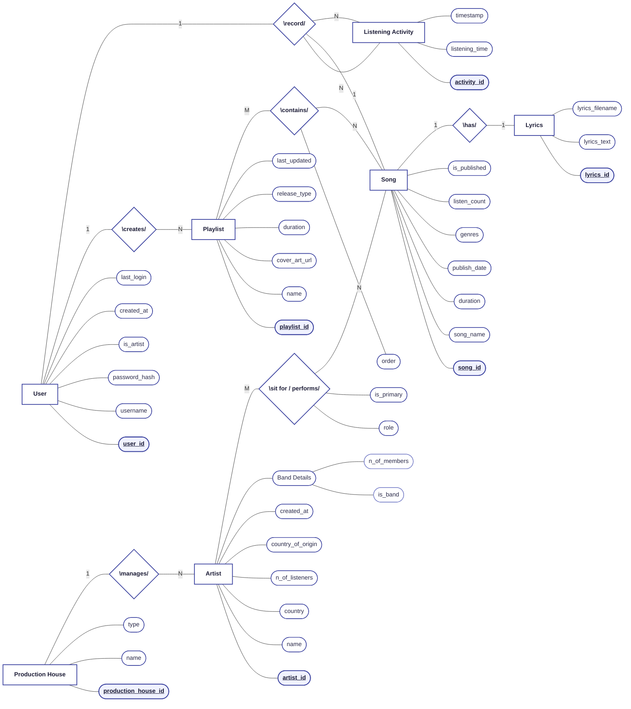
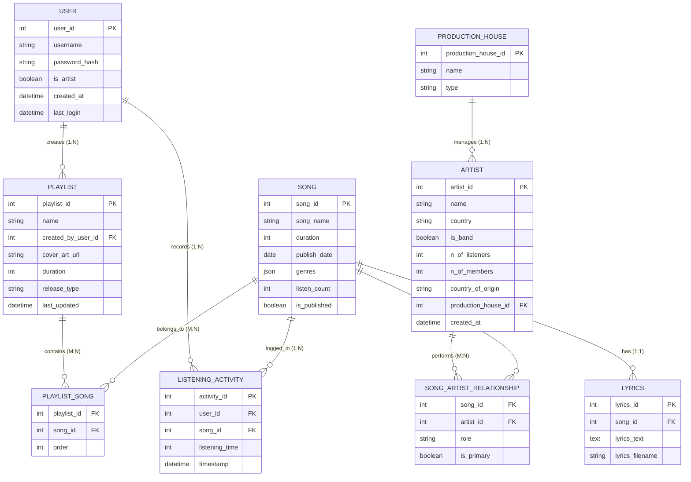

# Entity-Relationship (ER) Diagrams

This document presents the ER diagrams for the **Music Streaming Platform Database Schema** based on the refined tables in `archive/`.

---

## 1. Chen Notation ER Diagram (Conceptual Model)

*Matches the classical Chen Notation layout: Rectangles for **Entities**, Diamonds for **Relationships**, Ovals/Stadiums for **Attributes** (Primary Keys <u>underlined</u>), and branching for **Composite Attributes**.*

---

## 2. Relational Crow's Foot ER Diagram (Database Schema View)

