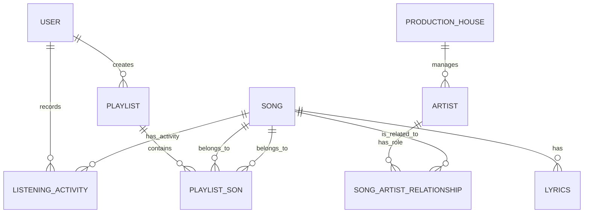

# Database Schema Refinement and Normalization Analysis

## 1. Normalization Level Chosen: Third Normal Form (3NF)

The refined schema achieves a high level of data integrity, targeting Third Normal Form (3NF). This is justified by the following decisions:

1.  **Elimination of Transitive Dependencies:** No non-key attributes are dependent on other non-key attributes. For example, in the `User` table, `username`, `created_at`, and `last_login` are dependent only on `user_id`.
2.  **Handling Multi-valued Attributes:** Attributes like `genres` in the `Song` table are handled via a linked table or JSON (as noted), avoiding repeating groups or violating 1NF/2NF if kept as a simple array/string.
3.  **Junction Tables for M:M Relationships:** Relationships between many-to-many entities (`Song` to `Artist`, `Playlist` to `Song`) are correctly modeled using junction tables (`Song_Artist_Relationship`, `Playlist_Song`), ensuring all relationship attributes (like `role` or `order`) are stored in the junction table, which is crucial for 3NF compliance.
4.  **Global Counters:** Attributes like `listen_count` in `Song` are kept as an attribute of the `Song` entity because the requirement is for a *global counter* of total listens, which is an aggregate property of the song, not a property of the individual listener's activity.

---

## 2. Finalized Table Structures

### Table 1: User
| Attribute | Data Type | Constraints | Description |
| :--- | :--- | :--- | :--- |
| `user_id` | INT (PK) | PK, NOT NULL | Unique identifier for the user. |
| `username` | VARCHAR | UNIQUE, NOT NULL | Unique username. |
| `password_hash` | VARCHAR | NOT NULL | Encrypted password hash. |
| `is_artist` | BOOLEAN | NOT NULL | Indicates if the user is an artist. |
| `created_at` | TIMESTAMP | NOT NULL | Account creation timestamp. |
| `last_login` | TIMESTAMP | NULLABLE | Last login timestamp. |

### Table 2: Listening_Activity
| Attribute | Data Type | Constraints | Description |
| :--- | :--- | :--- | :--- |
| `activity_id` | INT (PK) | PK, NOT NULL | Unique ID for the listening event. |
| `user_id` | INT | FK (User) | Foreign Key referencing `User`. |
| `song_id` | INT | FK (Song) | Foreign Key referencing `Song`. |
| `listening_time` | INT | NOT NULL | Listening duration in seconds. |
| `timestamp` | TIMESTAMP | NOT NULL | Time of listening activity. |

### Table 3: Song
| Attribute | Data Type | Constraints | Description |
| :--- | :--- | :--- | :--- |
| `song_id` | INT (PK) | PK, NOT NULL | Unique identifier for the song. |
| `song_name` | VARCHAR | NOT NULL | Required song name. |
| `duration` | INT | NOT NULL | Song duration in seconds. |
| `publish_date` | DATE | NULLABLE | Original publication date. |
| `genres` | JSON/Array | N/A | List of associated genres (JSON or Linked Table). |
| `listen_count` | INT | NOT NULL | Global count of listens for this song. |
| `is_published` | BOOLEAN | NOT NULL | Publication status. |

### Table 4: Artist
| Attribute | Data Type | Constraints | Description |
| :--- | :--- | :--- | :--- |
| `artist_id` | INT (PK) | PK, NOT NULL | Unique identifier for the artist. |
| `name` | VARCHAR | NOT NULL | Required artist name. |
| `country` | VARCHAR | INDEX | Artist's country. |
| `is_band` | BOOLEAN | NOT NULL | Indicates if the artist is a band. |
| `n_of_listeners` | INT | NOT NULL | Total number of listeners for the artist. |
| `n_of_members` | INT | NULLABLE | Number of band members. |
| `country_of_origin` | VARCHAR | NULLABLE | Artist's country of origin. |
| `production_house_id` | INT | FK (Production_House) | Production house associated with the artist. |
| `created_at` | TIMESTAMP | NOT NULL | Artist creation timestamp. |

### Table 5: Production_House
| Attribute | Data Type | Constraints | Description |
| :--- | :--- | :--- | :--- |
| `production_house_id` | INT (PK) | PK, NOT NULL | Unique identifier for the house. |
| `name` | VARCHAR | UNIQUE, NOT NULL | Unique name of the production house. |
| `type` | VARCHAR | NOT NULL | Type of house (e.g., 'Label', 'Studio'). |

### Table 6: Song_Artist_Relationship (Junction Table)
| Attribute | Data Type | Constraints | Description |
| :--- | :--- | :--- | :--- |
| `song_id` | INT | FK (Song) | Foreign Key to Song. |
| `artist_id` | INT | FK (Artist) | Foreign Key to Artist. |
| `role` | VARCHAR | NOT NULL | Role in the relationship (e.g., 'Main Artist'). |
| `is_primary` | BOOLEAN | NOT NULL | Indicates primary status. |

### Table 7: Lyrics
| Attribute | Data Type | Constraints | Description |
| :--- | :--- | :--- | :--- |
| `lyrics_id` | INT (PK) | PK, NOT NULL | Unique ID for the lyrics. |
| `song_id` | INT | FK (Song) | Foreign Key to Song. |
| `lyrics_text` | TEXT | NOT NULL | The full lyrics content. |
| `lyrics_filename` | VARCHAR | NOT NULL | Filename of the lyric file. |

### Table 8: Playlist
| Attribute | Data Type | Constraints | Description |
| :--- | :--- | :--- | :--- |
| `playlist_id` | INT (PK) | PK, NOT NULL | Unique identifier for the playlist. |
| `name` | VARCHAR | NOT NULL | Required name of the playlist. |
| `created_by_user_id` | INT | FK (User) | User who created the playlist. |
| `cover_art_url` | VARCHAR | NULLABLE | URL for the cover art. |
| `duration` | INT | NOT NULL | Total duration of the playlist. |
| `release_type` | ENUM | NOT NULL | Release type ('Single', 'EP', 'Album', 'User_Created'). |
| `last_updated` | TIMESTAMP | NOT NULL | Last update timestamp. |

### Table 9: Playlist_Song (Junction Table)
| Attribute | Data Type | Constraints | Description |
| :--- | :--- | :--- | :--- |
| `playlist_id` | INT | FK (Playlist) | Foreign Key to Playlist. |
| `song_id` | INT | FK (Song) | Foreign Key to Song. |
| `order` | INT | NOT NULL | The song's order in the playlist. |

---

## 3. Entity-Relationship (ER) Model (Mermaid Diagram)

The ER model defines the following relationships:
- **User** creates **Listening_Activity** (1:M).
- **Song** is associated with **Listening_Activity** (1:M).
- **Song** and **Artist** are linked via **Song_Artist_Relationship** (M:M).
- **Production_House** manages **Artist** (1:M).
- **Song** provides **Lyrics** (1:M).
- **Playlist** contains **Playlist_Song** (M:M).
- **Playlist_Song** links **Playlist** and **Song** (M:M).
- **User** creates **Playlist** (M:M).
